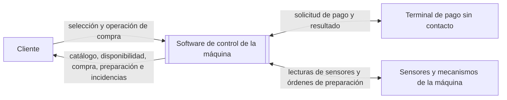

# Contexto y alcance del sistema

**Fuentes:** apartados 1.2 y 1.3 del [enunciado de la práctica](../enunciado/P1.docx.pdf) y el documento [requisitos iniciales v1](requisitos-v1.md), facilitado como referencia.

Las reglas de compra y las condiciones de calidad de este documento incorporan las decisiones comunicadas por el equipo durante la revisión de requisitos. Estas decisiones se distinguen de las funcionalidades generales indicadas por el enunciado.

## 1. Descripción general del sistema

El sistema objeto de estudio es el software de una máquina expendedora de café. Permite al cliente seleccionar y comprar una bebida. Además, coordina su preparación e informa de las incidencias que puedan afectar al servicio.

El enunciado establece cinco funcionalidades principales: seleccionar bebidas, gestionar el pago, comprobar la disponibilidad de ingredientes, preparar la bebida y comunicar incidencias al usuario. El alcance debe ser acotado; no se pretende desarrollar un sistema industrial completo.

El software controla las operaciones de una máquina de bebidas calientes en vaso: selección, pago, comprobación de existencias, preparación y comunicación de incidencias. Intercambia información con el terminal de pago sin contacto, los sensores y los mecanismos de preparación. No incluye funciones de administración. La modificación de existencias por un administrador podrá valorarse como posible ampliación futura, pero no forma parte del alcance acordado. El diseño y la fabricación del hardware quedan fuera del alcance.

**Límite del sistema e interacciones identificadas:**

El cliente interactúa con la aplicación a través de una pantalla y de los botones de la máquina.

**Términos utilizados:**

| Término | Significado en este documento |
| --- | --- |
| Bebida | Producto que el cliente puede seleccionar para su preparación. El catálogo y las recetas iniciales figuran en el apartado 3. |
| Ingrediente | Recurso necesario para preparar una bebida. Las cantidades figuran en las recetas del apartado 3. |
| Disponibilidad | Existencia de los ingredientes y vasos necesarios para preparar y entregar la bebida seleccionada. |
| Incidencia | Falta de disponibilidad, denegación del pago o fallo que impide entregar una bebida cuyo pago fue autorizado. |
| Receta | Definición de los ingredientes y cantidades necesarios para preparar una bebida. Las recetas iniciales se indican en el apartado 3. |
| Autorización de pago | Resultado comunicado por el terminal de pago sin contacto para indicar si se autoriza el cobro de la operación. |

## 2. Actores

| Actor | Necesidad u objetivo | Tipo |
| --- | --- | --- |
| Cliente | Seleccionar y comprar una bebida, recibirla y conocer las incidencias que puedan afectar a la compra. | Actor humano |
| Terminal de pago sin contacto | Comunicar la autorización o la denegación del pago solicitado por la aplicación. | Sistema externo |

El procesamiento bancario se realiza fuera de la aplicación. Esta recibe el resultado de la solicitud de pago a través del terminal. No se admiten pagos en efectivo.

### Necesidades de los interesados

Las siguientes necesidades describen lo que el cliente espera del sistema:

| Interesado | Necesidad |
| --- | --- |
| Cliente | Conocer las bebidas disponibles y su precio antes de elegir. |
| Cliente | Pagar la bebida seleccionada con tarjeta sin contacto. |
| Cliente | Recibir la bebida seleccionada. |
| Cliente | Conocer el motivo si no se entrega la bebida y recuperar el importe cuando corresponda. |

## 3. Alcance funcional

Las funciones siguientes delimitan el comportamiento general del software.

| Función | Descripción |
| --- | --- |
| Selección de bebidas | Mostrar el catálogo, los precios y la disponibilidad de cada bebida antes de que el cliente elija. El aviso de falta de disponibilidad no identifica el ingrediente o recurso concreto que falta. |
| Gestión del pago | Solicitar el pago al terminal de pago sin contacto una vez comprobada la disponibilidad de la bebida. Mientras la autorización está pendiente no se puede cancelar. Si se deniega, permitir que el cliente vuelva a intentarlo o cancele antes de iniciar otro intento, sin iniciar la preparación. |
| Comprobación de ingredientes y existencias | Comprobar, antes de solicitar el pago, que hay ingredientes y vasos suficientes para preparar la bebida seleccionada. Si no hay disponibilidad, informar al cliente de forma genérica y permitir que seleccione otra bebida o cancele, sin solicitar el pago. Actualizar las existencias según el consumo real al finalizar la preparación, incluso si falla. |
| Preparación de la bebida | Coordinar la preparación de la bebida según su receta y su entrega en un vaso. Para ello, utilizar los sensores y los mecanismos de la máquina, que dispone de un depósito interno de agua. |
| Comunicación de incidencias | Informar al cliente de la falta de disponibilidad, la denegación del pago y los fallos que impidan entregar una bebida cuyo pago fue autorizado. También comunicar el progreso y la finalización correcta de la preparación. |

**Catálogo y recetas iniciales:**

| Código | Bebida | Precio | Café molido (g) | Leche en polvo (g) | Cacao (g) | Agua (ml) |
| --- | --- | ---: | ---: | ---: | ---: | ---: |
| B1 | Café solo | 1,00 € | 7 | — | — | 40 |
| B2 | Café largo | 1,10 € | 7 | — | — | 120 |
| B3 | Cortado | 1,10 € | 7 | 4 | — | 60 |
| B4 | Café con leche | 1,20 € | 7 | 10 | — | 150 |
| B5 | Capuchino | 1,40 € | 7 | 14 | — | 150 |
| B6 | Chocolate | 1,30 € | — | — | 25 | 150 |

El agua procede de un depósito interno. Cada operación corresponde a una bebida. El catálogo, los precios, las recetas y las existencias iniciales son datos de partida; no se fijan aquí cantidades iniciales. La aplicación no incluye funciones para modificarlos ni para registrar reposiciones.

## 4. Fuera del alcance

Quedan fuera del alcance el diseño y la fabricación del hardware, así como el procesamiento bancario. La aplicación solicita el pago al terminal de pago sin contacto y recibe el resultado de la solicitud.

Cuando el terminal ha autorizado el pago y un fallo impide entregar la bebida, el sistema informa al cliente y solicita la devolución íntegra asociada a ese intento de pago. Esto se aplica si el fallo ocurre antes de iniciar, durante o después de la preparación, siempre que impida la entrega. El cliente recibe un aviso de que la devolución fue solicitada; no se garantiza aquí el resultado del procesamiento externo. Los fallos de la solicitud de devolución quedan fuera del alcance por decisión del equipo. No se solicita una devolución por cancelar antes de iniciar la autorización o por un pago denegado.

## 5. Supuestos

El sistema se define con los siguientes supuestos:

| Supuesto |
| --- |
| Se modela una única máquina y una bebida por operación de compra. |
| Solo se admite el pago con tarjeta sin contacto. |
| La aplicación no contempla un operador ni funciones de administración. El catálogo, los precios, las recetas y las existencias iniciales son datos de partida; no se definen cantidades concretas ni se incluye una función para ajustar el stock. La gestión por un administrador podrá considerarse en el futuro, sin constituir un requisito actual. |
| La máquina dispone de sensores, un depósito interno de agua y mecanismos para dispensar vasos y preparar bebidas. Comunica al software información suficiente para distinguir la preparación y entrega correctas de un fallo que impide entregar la bebida; no se especifica cómo detecta o reporta ese resultado. |
| Los mecanismos comunican al software las cantidades de ingredientes y el número de vasos realmente consumidos, incluso cuando la preparación falla. La medición física de esas cantidades queda fuera del alcance. |
| El cliente puede cancelar durante la selección y antes de iniciar el proceso de autorización del pago. No puede cancelar mientras una autorización está pendiente. Si el terminal deniega el pago, puede cancelar antes de solicitar un nuevo intento. Tras la autorización no puede cancelar, tampoco durante la preparación ni cuando la bebida está lista para recoger. |
| Si el terminal autoriza el pago y un fallo impide entregar la bebida en cualquier etapa, el sistema informa que el servicio no se completó, solicita la devolución íntegra asociada al intento autorizado y termina la operación sin iniciar automáticamente otra preparación o compra. |

Si la bebida seleccionada no está disponible, el cliente puede seleccionar directamente otra o cancelar. La nueva selección sustituye a la anterior y se comprueba su disponibilidad antes de solicitar el pago. En los demás casos, cambiar de bebida requiere cancelar la operación actual mientras esté permitido e iniciar una nueva. No se puede cambiar de bebida mientras la autorización esté pendiente ni después de ser aprobada.

Cuando se deniega el pago, se permiten reintentos sin un número máximo definido. El sistema deberá asociar la solicitud de devolución con el intento de pago autorizado correspondiente, sin que este documento prescriba si la referencia la conserva la aplicación o la gestiona el terminal. Si un fallo impide la entrega después de autorizar el pago, la operación termina con un aviso de servicio no completado y de que se solicitó la devolución. No se inicia otra compra ni preparación automáticamente. Los ingredientes y vasos se descuentan según el consumo real, aunque la preparación falle.

### Condiciones de calidad acordadas

El equipo ha aprobado que todos los textos dirigidos al cliente estén en español y que los importes de pago y devolución se manejen en céntimos exactos, sin errores de redondeo respecto al catálogo. Estas condiciones se detallan en los requisitos no funcionales de [requisitos v1](requisitos-v1.md). No se fija en esta versión un tiempo máximo para comunicar la disponibilidad.

## 6. Casos de uso principales

Los siguientes casos de uso resumen las interacciones principales del sistema.

La secuencia de una compra es: consulta del catálogo y disponibilidad → selección de la bebida → comprobación de disponibilidad → autorización del pago → preparación → entrega. La preparación solo comienza si hay ingredientes y vasos suficientes, el pago ha sido autorizado y no se ha comunicado un fallo que impida entregar la bebida. El cliente recibe el aviso de bebida lista solo tras confirmarse el resultado correcto de preparación y entrega.

| Caso de uso | Actor principal | Interacción y resultado esperado | Situaciones alternativas |
| --- | --- | --- | --- |
| Seleccionar una bebida | Cliente | El cliente consulta el catálogo, los precios y la disponibilidad, y elige una bebida. La aplicación comprueba ingredientes y vasos antes de solicitar el pago. | Si no hay disponibilidad, se informa genéricamente y se permite seleccionar directamente otra bebida o cancelar, sin solicitar el pago. En otros casos, cambiar de bebida requiere cancelar mientras esté permitido. |
| Pagar la bebida seleccionada | Cliente | Una vez comprobada la disponibilidad, la aplicación solicita el pago al terminal. El cliente utiliza una tarjeta sin contacto y la aplicación recibe el resultado. | Si se deniega el pago, el cliente puede reintentarlo sin un máximo definido o cancelar antes de otro intento. Mientras la autorización esté pendiente no se puede cancelar. No se prepara una bebida sin autorización. |
| Cancelar una compra | Cliente | El cliente cancela durante la selección y antes de iniciar la autorización, o tras recibir una denegación y antes de otro intento. La operación termina sin iniciar la preparación. | No se acepta la cancelación mientras una autorización está pendiente ni después de su aprobación, incluida la preparación y el estado de bebida lista. |
| Solicitar la preparación de una bebida | Cliente | Tras comprobar la disponibilidad y recibir la autorización del pago, la aplicación coordina la preparación y la entrega de la bebida seleccionada. | Si un fallo impide entregar la bebida, antes, durante o después de prepararla, se informa que el servicio no se completó, se solicita la devolución asociada al intento autorizado y se termina la operación sin iniciar automáticamente otra compra o preparación. Los recursos se descuentan según el consumo real. |
| Consultar una incidencia comunicada por la máquina | Cliente | La aplicación informa sobre la falta de disponibilidad, una denegación del pago o un fallo que impida entregar la bebida. | Ante un fallo que impida entregar una bebida con pago autorizado, se informa del servicio no completado y de la solicitud de devolución. El aviso de bebida lista solo aparece tras confirmarse una preparación y entrega correctas. |

La comprobación de ingredientes forma parte del proceso de compra y preparación. El cliente no la inicia como una operación independiente.
