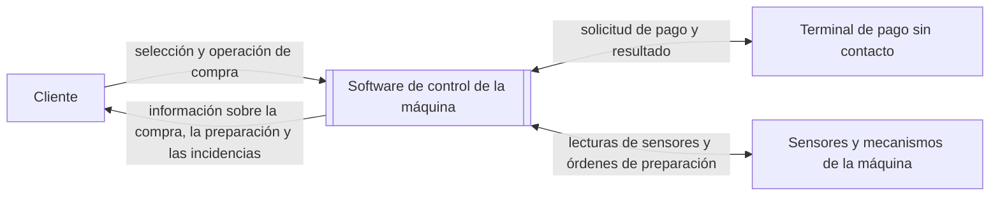

# Contexto y alcance del sistema

**Fuentes:** apartados 1.2 y 1.3 del [enunciado de la práctica](../enunciado/P1.docx.pdf) y documento `documento_requisitos_v1.md`, facilitado como referencia.

## 1. Descripción general del sistema

El sistema objeto de estudio es el software de una máquina expendedora de café. Permite al cliente seleccionar y comprar una bebida. Además, coordina su preparación e informa de las incidencias que puedan afectar al servicio.

El enunciado establece cinco funcionalidades principales: seleccionar bebidas, gestionar el pago, comprobar la disponibilidad de ingredientes, preparar la bebida y comunicar incidencias al usuario. El alcance debe ser acotado; no se pretende desarrollar un sistema industrial completo.

El software controla las operaciones de una máquina de bebidas calientes en vaso: selección, pago, comprobación de existencias, preparación y comunicación de incidencias. Intercambia información con el terminal de pago sin contacto, los sensores y los mecanismos de preparación. No incluye funciones de administración. El diseño y la fabricación del hardware quedan fuera del alcance.

**Límite del sistema e interacciones identificadas:**

El cliente interactúa con la aplicación a través de una pantalla y de los botones de la máquina.

**Términos utilizados:**

| Término | Significado en este documento |
| --- | --- |
| Bebida | Producto que el cliente puede seleccionar para su preparación. El catálogo y las recetas iniciales figuran en el apartado 3. |
| Ingrediente | Recurso necesario para preparar una bebida. Las cantidades figuran en las recetas del apartado 3. |
| Disponibilidad | Existencia de los ingredientes necesarios para preparar la bebida seleccionada. |
| Incidencia | Situación que impide prestar el servicio o altera su funcionamiento y que debe comunicarse al cliente. |
| Receta | Definición de los ingredientes y cantidades necesarios para preparar una bebida. Las recetas iniciales se indican en el apartado 3. |
| Autorización de pago | Resultado comunicado por el terminal de pago sin contacto para indicar si se autoriza el cobro de la operación. |

## 2. Actores

| Actor | Necesidad u objetivo | Tipo |
| --- | --- | --- |
| Cliente | Seleccionar y comprar una bebida, recibirla y conocer las incidencias que puedan afectar a la compra. | Actor humano |
| Terminal de pago sin contacto | Comunicar la autorización o la denegación del pago solicitado por la aplicación. | Sistema externo |

El procesamiento bancario se realiza fuera de la aplicación. Esta recibe el resultado de la solicitud de pago a través del terminal. No se admiten pagos en efectivo.

### Necesidades de los interesados

Las siguientes necesidades describen lo que el cliente espera del sistema:

| Interesado | Necesidad |
| --- | --- |
| Cliente | Conocer las bebidas disponibles y su precio antes de elegir. |
| Cliente | Pagar la bebida seleccionada con tarjeta sin contacto. |
| Cliente | Recibir la bebida seleccionada. |
| Cliente | Conocer el motivo si no se entrega la bebida y recuperar el importe cuando corresponda. |

## 3. Alcance funcional

Las funciones siguientes delimitan el comportamiento general del software.

| Función | Descripción |
| --- | --- |
| Selección de bebidas | Mostrar el catálogo y permitir que el cliente elija una bebida. |
| Gestión del pago | Solicitar el pago al terminal de pago sin contacto una vez comprobada la disponibilidad de la bebida. Si se deniega, permitir que el cliente vuelva a intentarlo o cancele la compra, sin iniciar la preparación. |
| Comprobación de ingredientes y existencias | Comprobar, antes de solicitar el pago, que hay ingredientes y vasos suficientes para preparar la bebida seleccionada. Si no hay disponibilidad, informar al cliente y no solicitar el pago. Actualizar las existencias una vez finalizada la preparación. |
| Preparación de la bebida | Coordinar la preparación de la bebida según su receta y su entrega en un vaso. Para ello, utilizar los sensores y los mecanismos de la máquina, que dispone de un depósito interno de agua. |
| Comunicación de incidencias | Informar al cliente de las incidencias que afecten al servicio, así como del progreso y de la finalización de la preparación. |

**Catálogo y recetas iniciales:**

| Código | Bebida | Precio | Café molido (g) | Leche en polvo (g) | Cacao (g) | Agua (ml) |
| --- | --- | ---: | ---: | ---: | ---: | ---: |
| B1 | Café solo | 1,00 € | 7 | — | — | 40 |
| B2 | Café largo | 1,10 € | 7 | — | — | 120 |
| B3 | Cortado | 1,10 € | 7 | 4 | — | 60 |
| B4 | Café con leche | 1,20 € | 7 | 10 | — | 150 |
| B5 | Capuchino | 1,40 € | 7 | 14 | — | 150 |
| B6 | Chocolate | 1,30 € | — | — | 25 | 150 |

El agua procede de un depósito interno. Cada operación corresponde a una bebida. El catálogo, los precios y las recetas son datos iniciales; la aplicación no incluye funciones para modificarlos ni para registrar reposiciones.

## 4. Fuera del alcance

Quedan fuera del alcance el diseño y la fabricación del hardware, así como el procesamiento bancario. La aplicación solicita el pago al terminal de pago sin contacto y recibe el resultado de la solicitud.

## 5. Supuestos

El sistema se define con los siguientes supuestos:

| Supuesto |
| --- |
| Se modela una única máquina y una bebida por operación de compra. |
| Solo se admite el pago con tarjeta sin contacto. |
| La aplicación no contempla un operador ni funciones de administración. El catálogo, los precios, las recetas y las existencias iniciales son datos de partida. |
| La máquina dispone de sensores, un depósito interno de agua y mecanismos para dispensar vasos y preparar bebidas. |
| El cliente puede cancelar la compra antes de que comience la preparación. Si ya se ha efectuado el cobro, se devuelve el importe al medio de pago utilizado. Si un fallo durante la preparación impide entregar la bebida, también se devuelve el importe. |

Para cambiar de bebida, el cliente debe cancelar la operación actual e iniciar una nueva. Si un fallo durante la preparación impide la entrega, la operación termina con un aviso y la devolución del importe cobrado. No se intenta preparar otra bebida automáticamente.

## 6. Casos de uso principales

Los siguientes casos de uso resumen las interacciones principales del sistema.

La secuencia de una compra es: selección de la bebida → comprobación de disponibilidad → pago → preparación → entrega. La preparación solo comienza si hay ingredientes y vasos suficientes y el pago ha sido autorizado.

| Caso de uso | Actor principal | Interacción y resultado esperado | Situaciones alternativas |
| --- | --- | --- | --- |
| Seleccionar una bebida | Cliente | El cliente consulta el catálogo y elige una bebida. La aplicación comprueba la disponibilidad de ingredientes y vasos antes de solicitar el pago. | Si no hay disponibilidad, se informa al cliente y no se solicita el pago. Para cambiar de bebida, el cliente cancela la operación e inicia otra. |
| Pagar la bebida seleccionada | Cliente | Una vez comprobada la disponibilidad, la aplicación solicita el pago al terminal. El cliente utiliza una tarjeta sin contacto y la aplicación recibe el resultado. | Si se deniega el pago, el cliente puede volver a intentarlo o cancelar. No se inicia la preparación. |
| Cancelar una compra | Cliente | El cliente cancela la compra antes de que comience la preparación. Si ya se ha efectuado el cobro, se devuelve el importe al medio de pago utilizado. | La cancelación deja de estar disponible al iniciarse la preparación. |
| Solicitar la preparación de una bebida | Cliente | Tras comprobar la disponibilidad y recibir la autorización del pago, la aplicación coordina la preparación y la entrega de la bebida seleccionada. | Si un fallo impide entregar la bebida, se informa al cliente y se devuelve el importe cobrado al medio de pago utilizado. La operación termina sin preparar otra bebida automáticamente. |
| Consultar una incidencia comunicada por la máquina | Cliente | La aplicación informa al cliente de un problema relacionado con la compra o con la preparación. | El mensaje y las acciones posteriores dependen de la incidencia y del estado de la operación. |

La comprobación de ingredientes forma parte del proceso de compra y preparación. El cliente no la inicia como una operación independiente.
