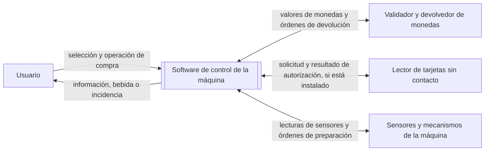

# Contexto y alcance del sistema

**Estado:** pendiente de revisión del equipo.

**Fuentes:** [enunciado de la práctica](../enunciado/P1.docx.pdf), apartados 1.2 y 1.3, y el documento `documento_requisitos_v1.md` facilitado para contraste. Este documento prepara la redacción de [requisitos v1](requisitos-v1.md), que todavía no contiene requisitos. La metodología se recoge en el [README](../../README.md).

**Decisiones de alcance comunicadas por el equipo:** catálogo, precios y recetas; medios de pago; equipamiento de la máquina; operaciones del personal; y política de cancelación y devolución. Se concretan en este documento. La decisión se comunicó el 27/10/2026; no se comunicó una justificación adicional.

## 1. Descripción general del sistema

El sistema objeto de estudio es el software de una máquina de café de vending. Su propósito es permitir que una persona seleccione una bebida y complete su compra y preparación, recibiendo información sobre las incidencias que puedan impedir el servicio.

El enunciado establece cinco funcionalidades principales: seleccionar bebidas, gestionar el pago, comprobar la disponibilidad de ingredientes, preparar la bebida y comunicar incidencias al usuario. El alcance debe ser acotado; no se pretende desarrollar un sistema industrial completo.

La frontera del sistema comprende el software que coordina selección, pago, control de existencias, preparación, incidencias y mantenimiento de la máquina de bebidas calientes en vaso. El software intercambia información con el validador y devolvedor de monedas, con el lector de tarjetas sin contacto cuando esté instalado y con los sensores y mecanismos de preparación. El diseño y la fabricación del hardware quedan fuera del alcance.

**Límite del sistema e interacciones identificadas:**

La interfaz con el usuario se realiza mediante pantalla y botones. En una eventual simulación, los dispositivos físicos se representarán mediante software; la realización del ejercicio 4 sigue siendo opcional según el enunciado.

Si se realiza el ejercicio 4, el enunciado permite implementar una simulación software. La decisión de realizarlo y el alcance de esa implementación siguen pendientes.

**Términos utilizados:**

| Término | Significado en este documento |
| --- | --- |
| Bebida | Producto que el usuario puede seleccionar para su preparación. El catálogo y las recetas iniciales figuran en el apartado 3. |
| Ingrediente | Recurso necesario para preparar una bebida. Los ingredientes y las cantidades se concretarán con las recetas. |
| Disponibilidad | Existencia de los ingredientes necesarios para preparar la bebida seleccionada. |
| Incidencia | Situación que impide o altera el servicio y que debe comunicarse al usuario. Los casos concretos se definirán en los requisitos. |
| Receta | Definición de los ingredientes y cantidades necesarios para preparar una bebida. Las recetas iniciales se indican en el apartado 3. |
| Crédito | Importe introducido por el usuario que todavía no se ha consumido ni devuelto durante una operación de compra. |

## 2. Actores

| Actor | Necesidad u objetivo | Situación |
| --- | --- | --- |
| Usuario de la máquina | Seleccionar una bebida, realizar el pago y recibir la bebida o información sobre la incidencia que impide obtenerla. | Actor principal identificado a partir del caso de estudio. |
| Operador | Reponer ingredientes, vasos y monedas; recoger la recaudación; modificar precios y consultar el estado, las ventas y las incidencias. | Actor incluido en el alcance; acceso al modo de mantenimiento mediante PIN. |

El lector de tarjetas es opcional. El procesamiento bancario se realiza externamente; el sistema recibe el resultado de autorización.

### Necesidades de los interesados

Estas necesidades ayudan a orientar los requisitos, pero todavía no son requisitos aprobados.

| Interesado | Necesidad | Estado |
| --- | --- | --- |
| Usuario de la máquina | Conocer las bebidas disponibles y su precio antes de elegir. | Cubierta por la presentación del catálogo y sus precios. |
| Usuario de la máquina | Pagar con las monedas admitidas o, si hay lector, con tarjeta; recibir cambio cuando corresponda. | Decisión de alcance comunicada por el equipo. |
| Usuario de la máquina | Recibir la bebida seleccionada o conocer por qué no se ha podido entregar y recuperar el dinero cuando corresponda. | La cancelación se permite antes de iniciar la preparación; si un fallo posterior impide entregar la bebida, se devuelve el importe. |
| Operador | Reponer y recaudar, configurar precios y consultar el estado de la máquina, las ventas y las incidencias. | Decisión de alcance comunicada por el equipo; acceso protegido mediante PIN. |

## 3. Alcance funcional

Las funciones siguientes concretan las cinco capacidades del enunciado y las decisiones adicionales de alcance comunicadas por el equipo. Son base para redactar requisitos detallados; todavía no constituyen requisitos identificados ni verificados.

| Función | Descripción | Aspectos por concretar |
| --- | --- | --- |
| Selección de bebidas | Mostrar y permitir seleccionar una bebida del catálogo, además de elegir un nivel de azúcar de 0 a 3. | Dosis de azúcar por nivel pendiente de definir. |
| Gestión del pago | Aceptar monedas de 0,05 €, 0,10 €, 0,20 €, 0,50 €, 1 € y 2 €; devolver cambio y permitir pago sin contacto cuando haya lector instalado. | Política detallada ante falta de cambio y respuesta a pagos con tarjeta denegados. |
| Comprobación de ingredientes y existencias | Comprobar ingredientes y vasos disponibles para la bebida elegida y mantener sus existencias. | Umbral de aviso de nivel bajo pendiente de definir. La secuencia exacta de comprobación y actualización se especificará en los requisitos. |
| Preparación de la bebida | Preparar y entregar en vaso la bebida conforme a la receta, usando el depósito de agua, sensores y mecanismos de preparación. | Umbrales de temperatura y tiempos no fijados en este documento. |
| Comunicación de incidencias | Informar al usuario de problemas que impidan o afecten al servicio y comunicar el progreso y fin de la preparación. | Mensajes y catálogo completo de incidencias se concretarán en los requisitos. |
| Mantenimiento | Permitir al operador acceder con PIN, reponer ingredientes, vasos y monedas, recoger la recaudación, modificar precios y consultar estado, ventas e incidencias. | Detalle de la interfaz y gestión de credenciales se concretará en los requisitos. |

**Catálogo y recetas iniciales:**

| Código | Bebida | Precio | Café molido (g) | Leche en polvo (g) | Cacao (g) | Agua (ml) |
| --- | --- | ---: | ---: | ---: | ---: | ---: |
| B1 | Café solo | 1,00 € | 7 | — | — | 40 |
| B2 | Café largo | 1,10 € | 7 | — | — | 120 |
| B3 | Cortado | 1,10 € | 7 | 4 | — | 60 |
| B4 | Café con leche | 1,20 € | 7 | 10 | — | 150 |
| B5 | Capuchino | 1,40 € | 7 | 14 | — | 150 |
| B6 | Chocolate | 1,30 € | — | — | 25 | 150 |

El usuario puede seleccionar un nivel de azúcar de 0 a 3; las dosis correspondientes están pendientes de definir. La moneda de trabajo es el euro. El agua procede de un depósito interno. El operador puede modificar los precios; la posible modificación de recetas y la cantidad de bebidas por operación siguen pendientes de concretar.

## 4. Fuera del alcance

El alcance del software no incluye el diseño ni la fabricación del hardware, el firmware del validador de monedas o el procesamiento bancario de las tarjetas. Para el pago con tarjeta, el software recibe el resultado de autorización.

## 5. Supuestos

Este apartado reúne las decisiones comunicadas por el equipo y los puntos que siguen pendientes de concretar al redactar los requisitos v1.

| Supuesto o decisión | Implicación | Estado |
| --- | --- | --- |
| El catálogo y las recetas iniciales son los que figuran en el apartado 3. | El operador puede modificar los precios. La posible modificación de recetas no está incluida en la decisión comunicada. | Acordado por el equipo. |
| La máquina acepta monedas de 0,05 €, 0,10 €, 0,20 €, 0,50 €, 1 € y 2 €; el pago sin contacto se admite cuando hay lector. | El sistema calcula el importe y devuelve cambio cuando corresponde. | Acordado por el equipo. |
| La máquina dispone de sensores y de un depósito interno de agua, además de mecanismos de dispensación de vasos y preparación. | El software usa los sensores y mecanismos para comprobar disponibilidad y coordinar la preparación. | Acordado por el equipo; tipos y señales concretos pendientes de especificar. |
| El límite del estudio se concreta a una única máquina. | No se modela la coordinación entre máquinas. | Pendiente de confirmar. |
| Una operación de compra corresponde a una bebida. | No se modelan compras múltiples en una operación. | Pendiente de confirmar. |

Pendientes de concretar al redactar los requisitos:

- Dosis por nivel de azúcar.
- Umbral que define cuándo el nivel de un ingrediente es bajo.
- Tipos y señales concretos de los sensores, incluidos los necesarios para ingredientes, vasos, agua, temperatura y presencia de vaso.
- Política si no hay cambio suficiente y comportamiento ante denegación de tarjeta.
- Secuencia detallada de selección, comprobación, pago y preparación.
- Si se admitirán billetes o aplicaciones móviles y si el operador podrá modificar recetas.
- Detalle de mensajes, credenciales del operador y consulta de ventas/incidencias.

La decisión sobre el ejercicio 4 y su tecnología puede abordarse posteriormente; no impide preparar los requisitos iniciales del ejercicio 1.

## 6. Casos de uso principales

Los casos siguientes resumen las funciones principales acordadas. No fijan todavía toda la secuencia de compra ni sustituyen a los requisitos y escenarios verificables.

| Caso de uso | Actor principal | Interacción y resultado esperado | Alternativas por concretar |
| --- | --- | --- | --- |
| Seleccionar una bebida | Usuario de la máquina | El usuario consulta las opciones ofrecidas y elige una bebida; el sistema registra la selección para continuar la compra. | Cambio de selección y opciones de personalización. |
| Pagar la bebida seleccionada | Usuario de la máquina | El usuario paga con monedas admitidas o, si hay lector, con tarjeta sin contacto. El sistema calcula el importe y el cambio que corresponda. | Pago insuficiente, tarjeta denegada o cambio insuficiente. |
| Cancelar una compra | Usuario de la máquina | El usuario puede cancelar y recibir el importe introducido antes de que comience la preparación. | La cancelación deja de estar disponible al iniciarse la preparación. |
| Solicitar la preparación de una bebida | Usuario de la máquina | El sistema comprueba ingredientes y vasos, prepara la receta seleccionada y entrega la bebida. | Si un fallo impide entregar la bebida después de iniciado el proceso, devuelve el importe. |
| Consultar una incidencia comunicada por la máquina | Usuario de la máquina | El sistema informa de un problema relacionado con la compra o preparación para que el usuario conozca la situación. | Mensaje y acciones posteriores según la incidencia y el estado de la operación. |
| Realizar operaciones de mantenimiento | Operador | El operador accede con PIN, repone ingredientes, vasos y monedas, recoge la recaudación, modifica precios y consulta estado, ventas e incidencias. | Acceso denegado si el PIN no es válido; detalle por definir en requisitos. |

La comprobación de ingredientes forma parte de la compra y preparación; no se presupone que el usuario tenga que iniciarla como una operación independiente.
