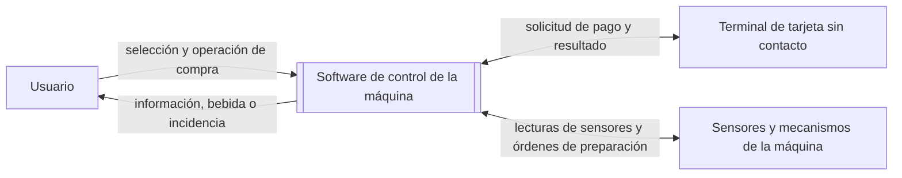

# Contexto y alcance del sistema

**Estado:** pendiente de revisión del equipo.

**Fuentes:** [enunciado de la práctica](../enunciado/P1.docx.pdf), apartados 1.2 y 1.3, y el documento `documento_requisitos_v1.md` facilitado para contraste. Este documento prepara la redacción de [requisitos v1](requisitos-v1.md), que todavía no contiene requisitos. La metodología se recoge en el [README](../../README.md).

**Decisiones de alcance comunicadas por el equipo:** una máquina, una bebida por compra, pago exclusivamente con tarjeta sin contacto y sin actor operador. Se mantienen el catálogo, los precios y las recetas iniciales acordados, así como la política de cancelación y devolución descrita abajo.

## 1. Descripción general del sistema

El sistema objeto de estudio es el software de una máquina de café de vending. Su propósito es permitir que una persona seleccione una bebida y complete su compra y preparación, recibiendo información sobre las incidencias que puedan impedir el servicio.

El enunciado establece cinco funcionalidades principales: seleccionar bebidas, gestionar el pago, comprobar la disponibilidad de ingredientes, preparar la bebida y comunicar incidencias al usuario. El alcance debe ser acotado; no se pretende desarrollar un sistema industrial completo.

La frontera del sistema comprende el software que coordina la selección, el pago, la comprobación de existencias, la preparación y la comunicación de incidencias de una máquina de bebidas calientes en vaso. El software intercambia información con el terminal de tarjeta sin contacto y con los sensores y mecanismos de preparación. No incluye funciones de administración para un operador. El diseño y la fabricación del hardware quedan fuera del alcance.

**Límite del sistema e interacciones identificadas:**

La interfaz con el cliente se realiza mediante pantalla y botones. En una eventual simulación, el terminal, los sensores y los mecanismos físicos se representarán mediante software; la realización del ejercicio 4 sigue siendo opcional según el enunciado.

Si se realiza el ejercicio 4, el enunciado permite implementar una simulación software. La decisión de realizarlo y el alcance de esa implementación siguen pendientes.

**Términos utilizados:**

| Término | Significado en este documento |
| --- | --- |
| Bebida | Producto que el usuario puede seleccionar para su preparación. El catálogo y las recetas iniciales figuran en el apartado 3. |
| Ingrediente | Recurso necesario para preparar una bebida. Los ingredientes y las cantidades se concretarán con las recetas. |
| Disponibilidad | Existencia de los ingredientes necesarios para preparar la bebida seleccionada. |
| Incidencia | Situación que impide o altera el servicio y que debe comunicarse al usuario. Los casos concretos se definirán en los requisitos. |
| Receta | Definición de los ingredientes y cantidades necesarios para preparar una bebida. Las recetas iniciales se indican en el apartado 3. |
| Autorización de pago | Resultado comunicado por el terminal de tarjeta para indicar si se autoriza el cobro de la operación. |

## 2. Actores

| Actor | Necesidad u objetivo | Situación |
| --- | --- | --- |
| Cliente | Seleccionar una bebida, pagar con tarjeta sin contacto y recibir la bebida o información sobre una incidencia. | Único actor humano. |
| Terminal de tarjeta sin contacto | Autorizar o denegar el pago solicitado por la aplicación. | Sistema externo con el que interactúa la aplicación. |

El procesamiento bancario se realiza externamente; la aplicación recibe el resultado de autorización del terminal. No se incluyen monedas ni efectivo.

### Necesidades de los interesados

Estas necesidades ayudan a orientar los requisitos, pero todavía no son requisitos aprobados.

| Interesado | Necesidad | Estado |
| --- | --- | --- |
| Cliente | Conocer las bebidas disponibles y su precio antes de elegir. | Cubierta por la presentación del catálogo y sus precios. |
| Cliente | Pagar la bebida seleccionada con tarjeta sin contacto. | Decisión de alcance comunicada por el equipo. |
| Cliente | Recibir la bebida seleccionada o conocer por qué no se ha podido entregar y recuperar el importe cuando corresponda. | Se admite cancelar antes de iniciar la preparación; si un fallo posterior impide la entrega, se devuelve el importe al medio de pago. |

## 3. Alcance funcional

Las funciones siguientes concretan las cinco capacidades del enunciado y las decisiones adicionales de alcance comunicadas por el equipo. Son base para redactar requisitos detallados; todavía no constituyen requisitos identificados ni verificados.

| Función | Descripción | Aspectos por concretar |
| --- | --- | --- |
| Selección de bebidas | Mostrar el catálogo y permitir al cliente seleccionar una bebida y un nivel de azúcar de 0 a 3. | Dosis de azúcar por nivel pendiente de definir. |
| Gestión del pago | Solicitar al terminal el pago de la bebida mediante tarjeta sin contacto y recibir el resultado. | Tratamiento de un pago denegado pendiente de concretar. |
| Comprobación de ingredientes y existencias | Comprobar si hay ingredientes y vasos suficientes para la bebida y actualizar las existencias tras su preparación. | Umbral de aviso de nivel bajo y momento exacto de actualización pendientes de definir. No se incluye una interfaz para reponer existencias. |
| Preparación de la bebida | Preparar y entregar en vaso la bebida conforme a la receta, usando el depósito de agua, sensores y mecanismos de preparación. | Umbrales de temperatura y tiempos no fijados en este documento. |
| Comunicación de incidencias | Informar al usuario de problemas que impidan o afecten al servicio y comunicar el progreso y fin de la preparación. | Mensajes y catálogo completo de incidencias se concretarán en los requisitos. |

**Catálogo y recetas iniciales:**

| Código | Bebida | Precio | Café molido (g) | Leche en polvo (g) | Cacao (g) | Agua (ml) |
| --- | --- | ---: | ---: | ---: | ---: | ---: |
| B1 | Café solo | 1,00 € | 7 | — | — | 40 |
| B2 | Café largo | 1,10 € | 7 | — | — | 120 |
| B3 | Cortado | 1,10 € | 7 | 4 | — | 60 |
| B4 | Café con leche | 1,20 € | 7 | 10 | — | 150 |
| B5 | Capuchino | 1,40 € | 7 | 14 | — | 150 |
| B6 | Chocolate | 1,30 € | — | — | 25 | 150 |

El cliente puede seleccionar un nivel de azúcar de 0 a 3; las dosis correspondientes están pendientes de definir. El agua procede de un depósito interno. Cada operación corresponde a una bebida. El catálogo, los precios y las recetas son datos iniciales; no hay funciones en la aplicación para modificarlos.

## 4. Fuera del alcance

El alcance del software no incluye el diseño ni la fabricación del hardware ni el procesamiento bancario. La aplicación solicita el pago al terminal de tarjeta sin contacto y recibe su resultado de autorización.

## 5. Supuestos

Este apartado reúne las decisiones comunicadas por el equipo y los puntos que siguen pendientes de concretar al redactar los requisitos v1.

| Supuesto o decisión | Implicación | Estado |
| --- | --- | --- |
| El estudio comprende una única máquina. | No se modela la coordinación entre máquinas. | Acordado por el equipo. |
| Cada operación corresponde a una bebida. | No se incluyen compras de varias bebidas en una misma operación. | Acordado por el equipo. |
| El único medio de pago es tarjeta sin contacto. | Se requiere un terminal; no se gestionan monedas ni cambio. | Acordado por el equipo. |
| No hay actor operador ni funciones de administración. | Catálogo, precios y recetas se utilizan como datos iniciales; no se modifican desde la aplicación ni se registran reposiciones. | Acordado por el equipo. |
| La máquina dispone de sensores, depósito interno de agua y mecanismos de dispensación y preparación. | El software consulta los sensores y coordina dichos mecanismos. | Acordado por el equipo; tipos y señales concretos pendientes de especificar. |

Pendientes de concretar al redactar los requisitos:

- Dosis por nivel de azúcar.
- Umbral que define cuándo el nivel de un ingrediente es bajo.
- Tipos y señales concretos de los sensores, incluidos los necesarios para ingredientes, vasos, agua, temperatura y presencia de vaso.
- Comportamiento ante denegación del pago con tarjeta.
- Secuencia detallada de selección, comprobación, pago y preparación.
- Mensajes concretos de incidencias.

La decisión sobre el ejercicio 4 y su tecnología puede abordarse posteriormente; no impide preparar los requisitos iniciales del ejercicio 1.

## 6. Casos de uso principales

Los casos siguientes resumen las funciones principales acordadas. No fijan todavía toda la secuencia de compra ni sustituyen a los requisitos y escenarios verificables.

| Caso de uso | Actor principal | Interacción y resultado esperado | Alternativas por concretar |
| --- | --- | --- | --- |
| Seleccionar una bebida | Cliente | El cliente consulta las opciones ofrecidas y elige una bebida; el sistema registra la selección para continuar la compra. | Cambio de selección y opciones de personalización. |
| Pagar la bebida seleccionada | Cliente | El cliente paga con tarjeta sin contacto; la aplicación solicita la operación al terminal y recibe el resultado. | Pago denegado. |
| Cancelar una compra | Cliente | El cliente puede cancelar antes de iniciar la preparación y se devuelve el importe al medio de pago. | La cancelación deja de estar disponible al iniciarse la preparación. |
| Solicitar la preparación de una bebida | Cliente | La aplicación comprueba ingredientes y vasos, prepara la receta seleccionada y entrega la bebida. | Si un fallo impide entregar la bebida después de iniciada la preparación, se devuelve el importe al medio de pago. |
| Consultar una incidencia comunicada por la máquina | Cliente | La aplicación informa de un problema relacionado con la compra o preparación. | Mensaje y acciones posteriores según la incidencia y el estado de la operación. |

La comprobación de ingredientes forma parte de la compra y preparación; no se inicia como una operación independiente del cliente.
