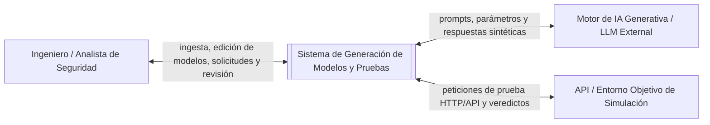

# Contexto y alcance del sistema

**Fuentes:** [enunciado de P1](../../enunciado/P1.docx.pdf), apartado 1.7; [enunciado del proyecto final](PROYECTO_FINAL.pdf), propuesta 5 «Generación automática de modelos y pruebas desde requisitos» (p. 6); [requisitos iniciales v1](requisitos-v1.md); y [decisiones de la evaluación general](../02-evaluacion-ia/evaluacion-y-decisiones.md).

**Estado:** contexto revisado y confirmado por el equipo, junto con la [v3](../03-evaluacion-incose/requisitos-v3.md), las decisiones de su [matriz](../03-evaluacion-incose/matriz-y-decisiones.md) y la comparativa crítica. El ejercicio 5 queda cerrado por confirmación del equipo. La [v2](../02-evaluacion-ia/requisitos-v2.md) se conserva como base confirmada de la evaluación INCOSE; v3 es la versión vigente.

El proyecto final pide generar modelos y pruebas, vincular requisito–modelo–prueba, ejecutar un subconjunto y presentar resultados y métricas, distinguiendo generación, validación y ejecución. La especialización en ciberseguridad, RBAC/ABAC, interfaz web y baseline manual procede del alcance del equipo. Los límites de 15 segundos y 85 % figuran en v1; no son valores exigidos por el profesor. Su verificabilidad se revisa en la matriz de v3.

La referencia anterior a `requisitos_sistema.md` no tenía un archivo disponible. Tampoco se dispone de una definición de OE1, OE2 y OE3; no se usan como fundamento de requisitos. Las respuestas originales de IA conservan esas limitaciones tal como se registraron al evaluar.

---

## 1. Descripción general del sistema

El sistema objeto de estudio es una plataforma asistida por Inteligencia Artificial Generativa diseñada para transformar especificaciones de requisitos de ciberseguridad expresadas en lenguaje natural o semiestructurado en modelos lógicos de autorización y casos de prueba automatizados.

El sistema establece una separación conceptual y funcional estricta entre tres fases consecutivas:
1. **Generación:** Análisis de requisitos mediante IA generativa para sintetizar modelos lógicos de control de acceso (RBAC/ABAC) y derivar especificaciones de prueba.
2. **Validación:** Comprobación estática (sintáctica, semántica y lógica) de la coherencia entre requisitos, modelos y pruebas, antes de cualquier ejecución externa.
3. **Ejecución:** Corrida efectiva de un subconjunto de pruebas sobre un entorno de simulación o API de referencia para evaluar los veredictos de seguridad.

El alcance debe ser acotado; no se pretende desarrollar un motor de reentrenamiento de LLM ni un entorno de despliegue directo de políticas en producción. El software se centra en la ingesta, la generación asistida por IA con supervisión humana (*human-in-the-loop*), la validación previa y la ejecución en una API de simulación o de referencia. Presenta cobertura de requisitos y tasa de éxito sin baseline; la comparación de reglas y casos requiere una referencia manual (*baseline*).

**Límite del sistema e interacciones identificadas:**

El analista de seguridad interactúa con la aplicación mediante una interfaz web para supervisar todo el ciclo de vida de la prueba.

**Términos utilizados:**

| Término | Significado en este documento |
| --- | --- |
| Requisito de Ciberseguridad | Declaración funcional o de seguridad que especifica una regla de control de acceso o restricción de autorización (alineada con OWASP ASVS o NIST SP 800-53). |
| Modelo Lógico | Estructura de autorización con sujetos/roles, recursos, acciones y reglas. Un modelo RBAC no exige atributos; ABAC incluye además atributos y condiciones. La asociación OWASP–RBAC y NIST–ABAC es una decisión de este proyecto, no una restricción de esos estándares. |
| Caso de Prueba de Seguridad | Especificación que define precondiciones, rol/sujeto solicitante, recurso, acción, datos de entrada y el resultado esperado (autorizado vs. denegado). |
| Validación Estática | Proceso de verificación sintáctica, semántica y lógica entre artefactos sin realizar peticiones HTTP ni ejecutar código en la API objetivo. |
| Trazabilidad | Enlace bidireccional de cada caso con un único requisito de ciberseguridad y una única regla del modelo. «Requisito de Seguridad» designa aquí el mismo elemento. |
| Referencia Manual (*Baseline*) | Conjunto de modelos de autorización y casos de prueba elaborados manualmente por expertos para servir como patrón de comparación (*benchmark*). |
| Veredicto | Pass si el código HTTP coincide con el asociado al resultado esperado del caso; Fail si se recibe otro código; Error si la API no responde o hay un error de red no controlado. El payload se registra, pero no decide por sí solo el veredicto. |
| Cobertura de requisitos | Porcentaje de requisitos segmentados con al menos un caso generado, sobre el total segmentado. No acredita que esos casos se hayan ejecutado ni que cubran todas las reglas. |
| Precisión de reglas | Porcentaje de reglas generadas coincidentes con el baseline, según la coincidencia definida en GMP-RNF-004. No mide por sí sola las reglas omitidas. |

---

## 2. Actores

| Actor | Necesidad u objetivo | Tipo |
| --- | --- | --- |
| Analista / Ingeniero de Seguridad | Cargar requisitos, revisar/editar modelos lógicos, validar coherencia estática, seleccionar y ejecutar pruebas, y consultar métricas de trazabilidad y cobertura. | Actor humano |
| Motor de IA Generativa | Procesar los prompts de análisis y sintetizar modelos lógicos, reglas de autorización y casos de prueba abstractos. | Sistema externo |
| API Objetivo / Entorno de Simulación | Recibir las peticiones HTTP/REST generadas por el motor de ejecución y responder con códigos de estado y payloads. La aplicación asigna el veredicto a partir del código. | Sistema externo |

El procesamiento generativo de lenguaje natural y la ejecución final ocurren en las fronteras del sistema. La aplicación coordina el flujo, aplica las reglas de validación estática y gestiona la persistencia de trazabilidad y métricas.

### Necesidades de los interesados

Las siguientes necesidades describen lo que el analista de seguridad espera del sistema:

| Interesado | Necesidad |
| --- | --- |
| Analista de Seguridad | Extraer y segmentar automáticamente requisitos desde documentos estructurados o no estructurados. |
| Analista de Seguridad | Visualizar y editar el modelo lógico de autorización sugerido por la IA antes de confirmar la creación de pruebas. |
| Analista de Seguridad | Disponer de pruebas nominales (acceso permitido) y excepcionales/ataque (acceso denegado) vinculadas a los requisitos. |
| Analista de Seguridad | Detectar incoherencias o contradicciones lógicas en los modelos antes de lanzar pruebas reales. |
| Analista de Seguridad | Evaluar el rendimiento y cobertura de la IA frente a un conjunto de referencia manual (*baseline*). |

---

## 3. Alcance funcional

Las funciones siguientes delimitan el comportamiento general del software.

| Función | Descripción |
| --- | --- |
| Ingesta y Segmentación | Cargar TXT, MD y PDF con texto extraíble, segmentar restricciones de acceso numeradas o en prosa y proponer etiquetas OWASP ASVS versión 4 o familia AC de NIST. El analista confirma o corrige las etiquetas antes de generar el modelo. No se exige OCR. |
| Generación de Modelos Lógicos | Generar RBAC para requisitos OWASP y ABAC para requisitos NIST; con ambas etiquetas se incluyen elementos de ambos tipos. Permitir inspección, edición y confirmación humana. |
| Generación de Casos de Prueba | Derivar al menos un caso autorizado y otro denegado por regla del modelo confirmado por el analista. Guardarlos en Pendiente sin ejecutarlos. «Confirmado» no significa que ya se haya realizado la validación estática. |
| Validación Estática de Artefactos | Comprobar campos obligatorios, referencias a elementos del modelo y coherencia lógica. Emitir un informe de las versiones actuales antes de ejecutar: Error impide la ejecución y Advertencia no. La fidelidad a la intención del requisito se revisa por el analista mediante el contraste de requisito y reglas antes de confirmar el modelo (REV-002). |
| Ejecución Seleccionada de Pruebas | Permitir la selección de un subconjunto de pruebas y ejecutarlas contra la API de referencia/simulación, registrando el código de respuesta y veredicto. |
| Trazabilidad y Evaluación | Mantener el enlace requisito–regla–caso, calcular cobertura y tasa de éxito sin baseline y, si se importa uno, comparar precisión, reglas manuales representadas y recuentos de reglas y casos sin Error de validación. Con cero requisitos, la cobertura es «No aplicable»; con cero reglas manuales, también lo es el porcentaje de reglas del baseline representadas. |

**Estándares y Artefactos de Referencia:**

| Estándar / Marco | Enfoque Principal | Formatos Admitidos | Modelos Soportados |
| --- | --- | --- | --- |
| OWASP ASVS V4 | Control de Acceso y Gestión de Sesiones | TXT, Markdown, PDF | RBAC (Basado en Roles) |
| NIST SP 800-53 | Controles de Seguridad AC (Access Control) | TXT, Markdown, PDF | ABAC (Basado en Atributos) |

«V4» significa versión 4 de OWASP ASVS. La gestión de sesiones solo continúa hacia el modelo si expresa una restricción de autorización; autenticación no es una etiqueta del catálogo. No se ha fijado revisión concreta de NIST. La tabla acota el proyecto y no establece equivalencias normativas entre los estándares y los modelos.

---

## 4. Fuera del alcance

Quedan fuera del alcance del sistema:
* El ajuste fino (*fine-tuning*) o reentrenamiento pesado de modelos de lenguaje subyacentes.
* La corrección automática de vulnerabilidades directamente en el código fuente de la API objetivo.
* La ejecución destructiva o no autorizada de pruebas sobre entornos de producción reales.
* La conversión automática del modelo lógico en código ejecutable de políticas para motores de autorización específicos de terceros (p. ej., políticas Open Policy Agent en OPA) más allá de la estructura lógica representada en la aplicación.
* La auditoría física de sistemas de red o infraestructura subyacente.

---

## 5. Supuestos

El sistema se define con los siguientes supuestos:

| Supuesto |
| --- |
| Los documentos de requisitos ingresados están redactados en español o inglés y contienen especificaciones de control de acceso. |
| La API objetivo de simulación expone interfaces HTTP/REST accesibles e inocuas para la ejecución de pruebas de autorización. |
| El modelo de IA generativa externo se encuentra disponible a través de su correspondiente API web. |
| El analista de seguridad actúa como supervisor (*human-in-the-loop*), con la capacidad de modificar el modelo lógico o corregir casos de prueba antes de autorizar la ejecución. |
| La validación estática es obligatoria antes de ejecutar. Los errores sintácticos, semánticos y lógicos impiden iniciar la ejecución. La ausencia de casos para un requisito segmentado es Advertencia: se muestra y no bloquea. |
| El baseline manual es la referencia de la comparación de reglas y casos. La cobertura absoluta y la tasa de éxito no dependen de él. |

Si un requisito de ciberseguridad es ambiguo, la IA sugerirá una interpretación dentro del modelo lógico que el usuario deberá revisar al confirmar. La edición del modelo actualiza las precondiciones de generación posterior y conserva el contenido de los casos Pendiente ya guardados. Tras cambios en los artefactos del alcance validado, se exige una nueva validación antes de ejecutar (REV-003 confirmado); conservar el contenido de los casos no conserva la vigencia del informe anterior.

---

## 6. Casos de uso principales

La secuencia general del flujo de trabajo es: Carga e ingesta de requisitos $\rightarrow$ Análisis y generación del modelo lógico $\rightarrow$ Revisión/Edición humana $\rightarrow$ Generación de casos de prueba $\rightarrow$ Validación estática $\rightarrow$ Ejecución del subconjunto seleccionado $\rightarrow$ Evaluación de trazabilidad e informes.

| Caso de uso | Actor principal | Interacción y resultado esperado | Situaciones alternativas |
| --- | --- | --- | --- |
| Ingestar y segmentar requisitos | Analista de Seguridad | El analista carga TXT, MD o PDF con texto extraíble; el sistema segmenta restricciones de acceso y propone etiquetas que el analista confirma o corrige. | Durante la revisión de ingesta, antes de confirmar el modelo, el analista puede corregir texto e identificadores. Un identificador duplicado se rechaza y conserva el anterior. Un PDF sin texto no produce requisitos. |
| Generar y revisar modelo lógico | Analista de Seguridad | La IA analiza los requisitos y genera el esquema RBAC/ABAC (roles, permisos, atributos). El analista revisa y ajusta las reglas. | Si el usuario edita o añade una regla manual, el sistema actualiza la estructura lógica y la persiste para la fase de pruebas. |
| Generar casos de prueba | Analista de Seguridad | El sistema deriva pruebas de acceso autorizado y denegado vinculadas a cada regla del modelo lógico. Quedan guardadas como «Pendientes». | El usuario puede solicitar regenerar pruebas específicas ajustando los parámetros de temperatura/prompt del motor. |
| Validar artefactos estáticamente | Analista de Seguridad | El sistema comprueba campos, referencias y coherencia lógica sin llamar a la API de destino y emite el informe. | Con Error, se impide ejecutar; con solo Advertencia, se informa y se permite ejecutar. Superar esas comprobaciones no demuestra por sí solo fidelidad semántica al requisito original. |
| Ejecutar subconjunto de pruebas | Analista de Seguridad | El analista selecciona las pruebas que desea lanzar contra la API objetivo. El sistema envía las peticiones y asigna veredictos (*Pass*/*Fail*/*Error*). | Si la API objetivo no responde o devuelve un error no controlado de red, la prueba se registra con el veredicto *Error*. |
| Evaluar cobertura y comparar con *baseline* | Analista de Seguridad | El sistema calcula las métricas de cobertura de requisitos, la tasa de veredictos y compara la precisión frente a un *baseline* manual. | Si no se ha importado un *baseline* manual, el sistema muestra únicamente las métricas absolutas de cobertura y ejecución. |

## 7. Cierre y limitaciones conservadas

El equipo ha confirmado las recomendaciones justificadas para las 18 observaciones INCOSE y los asuntos REV-001 a REV-005: descomposición sin redundancia, revisión humana de fidelidad requisito–modelo, vigencia de validación, marco de medida del rendimiento y límites de las métricas. La v1 y la v2 se conservan como bases históricas de las evaluaciones. No consta patrón formal para R1 y faltan los datos concretos de corpus, configuración, entorno y repeticiones para verificar el compromiso de 15 s. La confirmación documental no acredita pruebas ejecutadas ni conformidad con toda la guía INCOSE.
