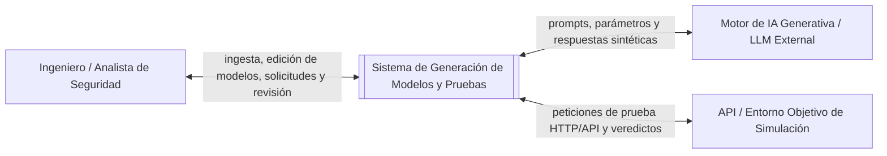

# Contexto y alcance del sistema

**Fuentes:** [Especificación de Requisitos v1](requisitos_sistema.md) y la propuesta del proyecto para el **Sistema de Generación Automática de Modelos y Pruebas de Ciberseguridad mediante IA Generativa**.

Las reglas de generación, validación estática y evaluación de este documento incorporan las decisiones del equipo de proyecto para acotar y estructurar el desarrollo del sistema, guiados por los objetivos general y específicos (OE1, OE2, OE3).

---

## 1. Descripción general del sistema

El sistema objeto de estudio es una plataforma asistida por Inteligencia Artificial Generativa diseñada para transformar especificaciones de requisitos de ciberseguridad expresadas en lenguaje natural o semiestructurado en modelos lógicos de autorización y casos de prueba automatizados.

El sistema establece una separación conceptual y funcional estricta entre tres fases consecutivas:
1. **Generación:** Análisis de requisitos mediante IA generativa para sintetizar modelos lógicos de control de acceso (RBAC/ABAC) y derivar especificaciones de prueba.
2. **Validación:** Comprobación estática (sintáctica, semántica y lógica) de la coherencia entre requisitos, modelos y pruebas, antes de cualquier ejecución externa.
3. **Ejecución:** Corrida efectiva de un subconjunto de pruebas sobre un entorno de simulación o API de referencia para evaluar los veredictos de seguridad.

El alcance debe ser acotado; no se pretende desarrollar un motor de reentrenamiento de LLM ni un entorno de despliegue directo de políticas en producción. El software se centra en la ingesta, la generación asistida por IA con supervisión humana (*human-in-the-loop*), la validación previa, la ejecución en sandbox/API y la presentación de métricas de trazabilidad y cobertura frente a un modelo de referencia manual (*baseline*).

**Límite del sistema e interacciones identificadas:**

El analista de seguridad interactúa con la aplicación mediante una interfaz web para supervisar todo el ciclo de vida de la prueba.

**Términos utilizados:**

| Término | Significado en este documento |
| --- | --- |
| Requisito de Ciberseguridad | Declaración funcional o de seguridad que especifica una regla de control de acceso o restricción de autorización (alineada con OWASP ASVS o NIST SP 800-53). |
| Modelo Lógico | Estructura formal de control de acceso expresada en términos de sujetos/roles, recursos, acciones, atributos y condiciones (modelos RBAC o ABAC). |
| Caso de Prueba de Seguridad | Especificación que define precondiciones, rol/sujeto solicitante, recurso, acción, datos de entrada y el resultado esperado (autorizado vs. denegado). |
| Validación Estática | Proceso de verificación sintáctica, semántica y lógica entre artefactos sin realizar peticiones HTTP ni ejecutar código en la API objetivo. |
| Trazabilidad | Enlace bidireccional que relaciona un Requisito de Seguridad $\leftrightarrow$ Elemento del Modelo Lógico $\leftrightarrow$ Caso de Prueba. |
| Referencia Manual (*Baseline*) | Conjunto de modelos de autorización y casos de prueba elaborados manualmente por expertos para servir como patrón de comparación (*benchmark*). |
| Veredicto | Resultado final de la ejecución de una prueba sobre la API objetivo (*Pass*, *Fail*, *Error*). |

---

## 2. Actores

| Actor | Necesidad u objetivo | Tipo |
| --- | --- | --- |
| Analista / Ingeniero de Seguridad | Cargar requisitos, revisar/editar modelos lógicos, validar coherencia estática, seleccionar y ejecutar pruebas, y consultar métricas de trazabilidad y cobertura. | Actor humano |
| Motor de IA Generativa | Procesar los prompts de análisis y sintetizar modelos lógicos, reglas de autorización y casos de prueba abstractos. | Sistema externo |
| API Objetivo / Entorno de Simulación | Recibir las peticiones HTTP/REST generadas por el motor de ejecución y responder con los códigos de estado y payloads para determinar el veredicto. | Sistema externo |

El procesamiento generativo de lenguaje natural y la ejecución final ocurren en las fronteras del sistema. La aplicación coordina el flujo, aplica las reglas de validación estática y gestiona la persistencia de trazabilidad y métricas.

### Necesidades de los interesados

Las siguientes necesidades describen lo que el analista de seguridad espera del sistema:

| Interesado | Necesidad |
| --- | --- |
| Analista de Seguridad | Extraer y segmentar automáticamente requisitos desde documentos estructurados o no estructurados. |
| Analista de Seguridad | Visualizar y editar el modelo lógico de autorización sugerido por la IA antes de confirmar la creación de pruebas. |
| Analista de Seguridad | Disponer de pruebas nominales (acceso permitido) y excepcionales/ataque (acceso denegado) vinculadas a los requisitos. |
| Analista de Seguridad | Detectar incoherencias o contradicciones lógicas en los modelos antes de lanzar pruebas reales. |
| Analista de Seguridad | Evaluar el rendimiento y cobertura de la IA frente a un conjunto de referencia manual (*baseline*). |

---

## 3. Alcance funcional

Las funciones siguientes delimitan el comportamiento general del software.

| Función | Descripción |
| --- | --- |
| Ingesta y Segmentación | Cargar documentos de requisitos (TXT, MD, PDF), extraer enunciados individuales y clasificarlos según estándares de referencia (OWASP ASVS, NIST). |
| Generación de Modelos Lógicos | Transformar requisitos analizados en estructuras de control de acceso (RBAC/ABAC) mediante IA generativa, permitiendo la edición e inspección humana. |
| Generación de Casos de Prueba | Derivar pruebas de seguridad nominales y de ataque a partir del modelo lógico verificado, manteniéndolas en estado «Pendiente» sin ejecutarlas. |
| Validación Estática de Artefactos | Comprobar la coherencia semántica y lógica entre requisitos, modelo y pruebas. Emitir un informe de discrepancias o inconsistencias sin realizar ejecuciones. |
| Ejecución Seleccionada de Pruebas | Permitir la selección de un subconjunto de pruebas y ejecutarlas contra la API de referencia/simulación, registrando el código de respuesta y veredicto. |
| Trazabilidad y Evaluación | Mantener la matriz de trazabilidad bidireccional, calcular la cobertura ($C = \frac{R_{\text{cubiertos}}}{R_{\text{totales}}} \times 100$) y comparar métricas frente a un *baseline* manual. |

**Estándares y Artefactos de Referencia:**

| Estándar / Marco | Enfoque Principal | Formatos Admitidos | Modelos Soportados |
| --- | --- | --- | --- |
| OWASP ASVS V4 | Control de Acceso y Gestión de Sesiones | TXT, Markdown, PDF | RBAC (Basado en Roles) |
| NIST SP 800-53 | Controles de Seguridad AC (Access Control) | TXT, Markdown, PDF | ABAC (Basado en Atributos) |

---

## 4. Fuera del alcance

Quedan fuera del alcance del sistema:
* El ajuste fino (*fine-tuning*) o reentrenamiento pesado de modelos de lenguaje subyacentes.
* La corrección automática de vulnerabilidades directamente en el código fuente de la API objetivo.
* La ejecución destructiva o no autorizada de pruebas sobre entornos de producción reales.
* La conversión automática del modelo lógico en código ejecutable de políticas para motores de autorización específicos de terceros (p. ej., políticas Open Policy Agent en OPA) más allá de la estructura lógica representada en la aplicación.
* La auditoría física de sistemas de red o infraestructura subyacente.

---

## 5. Supuestos

El sistema se define con los siguientes supuestos:

| Supuesto |
| --- |
| Los documentos de requisitos ingresados están redactados en español o inglés y contienen especificaciones de control de acceso. |
| La API objetivo de simulación expone interfaces HTTP/REST accesibles e inocuas para la ejecución de pruebas de autorización. |
| El modelo de IA generativa externo se encuentra disponible a través de su correspondiente API web. |
| El analista de seguridad actúa como supervisor (*human-in-the-loop*), con la capacidad de modificar el modelo lógico o corregir casos de prueba antes de autorizar la ejecución. |
| La fase de validación estática es obligatoria previa a la ejecución dinámica; el sistema puede advertir al usuario si intenta ejecutar pruebas sobre un modelo con fallos críticos no corregidos. |
| El cálculo de métricas de cobertura y precisión toma como estándar de comparación (*ground truth*) los datos importados como *baseline* manual por el usuario. |

Si un requisito de ciberseguridad es ambiguo, la IA sugerirá una interpretación dentro del modelo lógico que el usuario deberá revisar o validar. La edición manual de un modelo lógico actualiza automáticamente las precondiciones de generación para los casos de prueba posteriores.

---

## 6. Casos de uso principales

La secuencia general del flujo de trabajo es: Carga e ingesta de requisitos $\rightarrow$ Análisis y generación del modelo lógico $\rightarrow$ Revisión/Edición humana $\rightarrow$ Generación de casos de prueba $\rightarrow$ Validación estática $\rightarrow$ Ejecución del subconjunto seleccionado $\rightarrow$ Evaluación de trazabilidad e informes.

| Caso de uso | Actor principal | Interacción y resultado esperado | Situaciones alternativas |
| --- | --- | --- | --- |
| Ingestar y segmentar requisitos | Analista de Seguridad | El analista carga una especificación (PDF/MD/TXT); el sistema extrae e identifica requisitos individuales etiquetados con estándares (OWASP/NIST). | Si la extracción detecta enunciados ambiguos, el analista puede modificar manualmente el texto o los identificadores asignados. |
| Generar y revisar modelo lógico | Analista de Seguridad | La IA analiza los requisitos y genera el esquema RBAC/ABAC (roles, permisos, atributos). El analista revisa y ajusta las reglas. | Si el usuario edita o añade una regla manual, el sistema actualiza la estructura lógica y la persiste para la fase de pruebas. |
| Generar casos de prueba | Analista de Seguridad | El sistema deriva pruebas de acceso autorizado y denegado vinculadas a cada regla del modelo lógico. Quedan guardadas como «Pendientes». | El usuario puede solicitar regenerar pruebas específicas ajustando los parámetros de temperatura/prompt del motor. |
| Validar artefactos estáticamente | Analista de Seguridad | El sistema ejecuta el motor de comprobación sintáctica y lógica sin llamar a la API externa, emitiendo un reporte de consistencia. | Si se detectan contradicciones (p. ej. rol sin permisos), el sistema marca las alertas y recomienda corregir el modelo antes de ejecutar. |
| Ejecutar subconjunto de pruebas | Analista de Seguridad | El analista selecciona las pruebas que desea lanzar contra la API objetivo. El sistema envía las peticiones y asigna veredictos (*Pass*/*Fail*/*Error*). | Si la API objetivo no responde o devuelve un error no controlado de red, la prueba se registra con el veredicto *Error*. |
| Evaluar cobertura y comparar con *baseline* | Analista de Seguridad | El sistema calcula las métricas de cobertura de requisitos, la tasa de veredictos y compara la precisión frente a un *baseline* manual. | Si no se ha importado un *baseline* manual, el sistema muestra únicamente las métricas absolutas de cobertura y ejecución. |